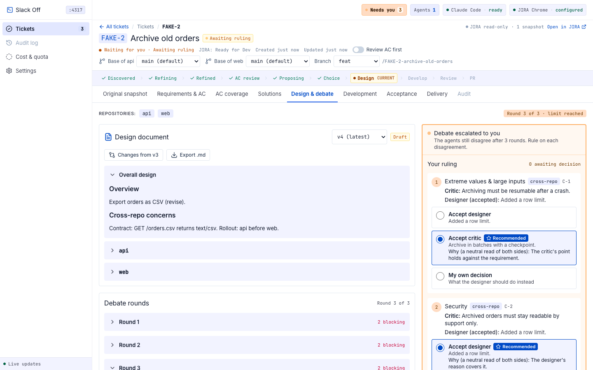
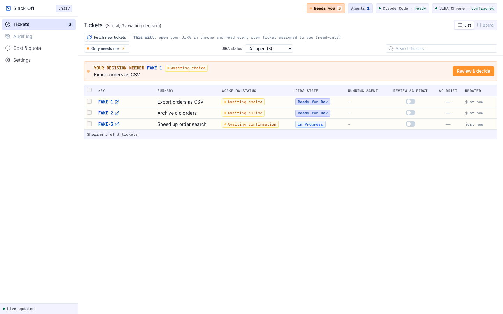
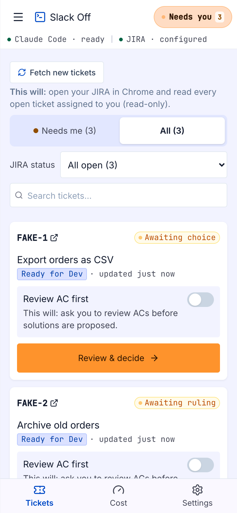
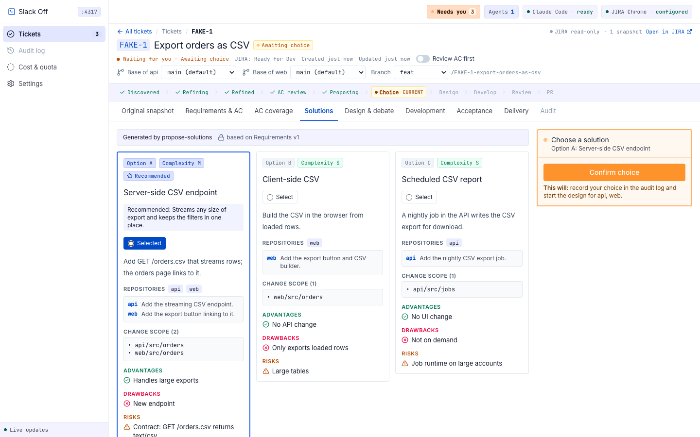
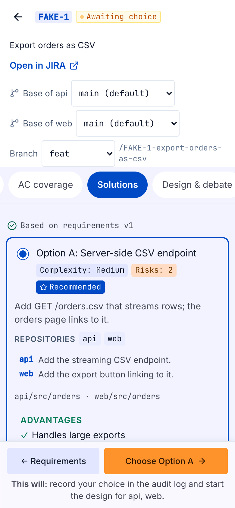
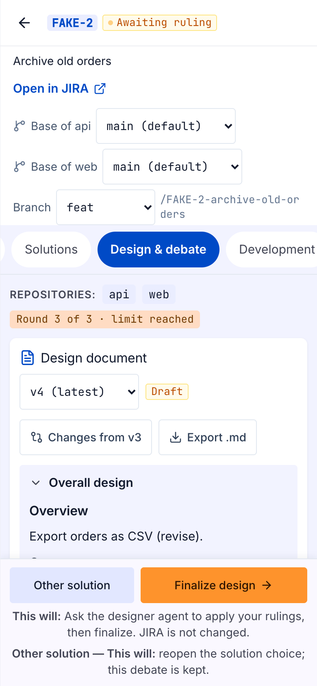
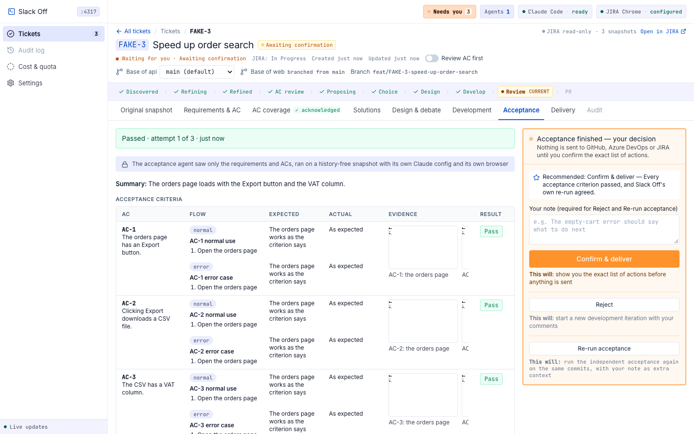
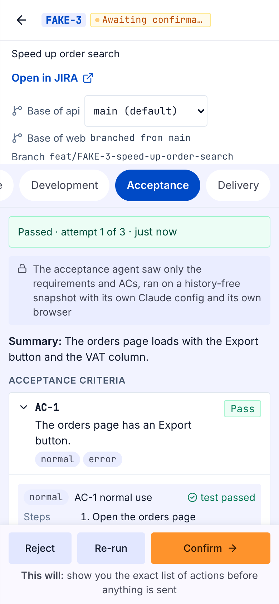
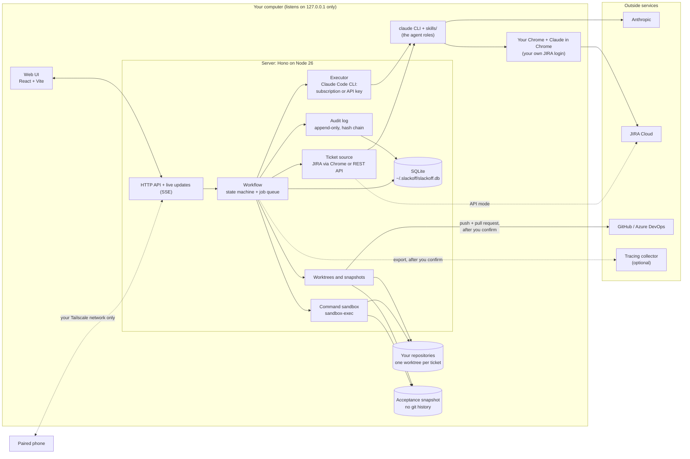
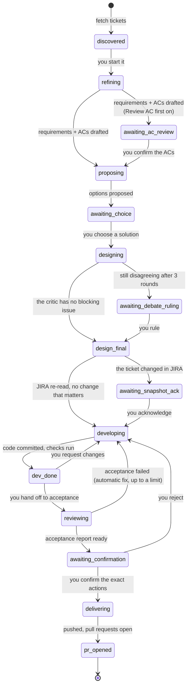

# Slack Off

A local, open-source platform that takes a JIRA ticket from "Ready for Dev" to reviewed requirements, a chosen solution, a debated design, committed code, an independent acceptance report and pull requests: agents (the local Claude Code CLI) do the reading, drafting, coding and testing, and you make every decision, from your desk or your phone.



## Before you start: is this allowed at your company?

Slack Off sends your JIRA ticket content and your repositories' code to Claude, through the Claude Code CLI on your computer. **Whether sending code and ticket content to an AI complies with your company's policy is your own call.** Check the policy before you point Slack Off at work tickets or work repositories, and check it again before you turn on run tracing, which sends run details to a third-party service.

How Slack Off reaches JIRA and Claude, in plain terms:

- **JIRA, browser mode (the default). No API token needed: uses your own browser login.** An agent reads JIRA in your own Chrome through the Claude in Chrome extension, as you would. Slack Off never reads or stores that login.
- **JIRA, API mode.** Slack Off calls Jira Cloud's REST API with an API token you create in your Atlassian account (never your JIRA password).
- **Claude, subscription mode (the default).** Slack Off runs the `claude` CLI that you installed and logged in to. It never reads or stores that login.
- **Claude, API-key mode.** The same CLI, authenticated with an Anthropic API key you enter in Settings.

Everything runs on your computer. Slack Off listens on `127.0.0.1` only, unless you turn on remote access over your own Tailscale network.

## What it does

A ticket goes through these steps. Each step ends with a decision that is yours:

1. **Discover.** Fetch the open tickets assigned to you. Slack Off freezes an immutable snapshot of each ticket it works on (text, comments, attachments).
2. **Requirements and acceptance criteria.** An agent turns the ticket into requirements and acceptance criteria (ACs), each traced to its source in the ticket. You review and edit them; a drift check compares them with the original text. If the ticket is unclear, the agent drafts a comment to the reporter, which you can edit and send.
3. **Solutions.** An agent proposes options with their complexity, dependencies and affected repositories. You choose one.
4. **Design debate.** A designer agent writes a design, a critic agent reviews it against a quality checklist, round after round. Where they still disagree, you rule.
5. **Development.** An agent writes the code in git worktrees of every affected repository, in steps; the platform runs your repository's own build, lint and test commands and git hooks, and makes the commits.
6. **Independent acceptance.** A separate agent that sees only the requirements and ACs tests a history-free copy of the committed code end to end, and writes a report with evidence. Failures go back to development automatically, up to a limit. You confirm, reject or re-run.
7. **Delivery.** After you confirm an exact list of actions: push, one pull request per repository, and (if you turned it on) the JIRA status change and a comment with the PR links.

**Every outward action — push, pull request, JIRA status, JIRA comment, trace export — happens only after you confirm it.** The confirmation shows exactly what will be sent; nothing else is. Every decision is recorded in an append-only audit log, with the device that made it.

### Discover and refine

- **Fetch new tickets** reads every open ticket assigned to you (`assignee = currentUser() AND statusCategory != Done`), up to Settings → **Most tickets per fetch** (default 100, 1–500). If you have more, the Tickets list says "Showing X of Y open tickets — raise the limit in Settings". The **Ready-for-dev status** (default `Ready for Dev`) is the default filter and highlight; you decide per ticket what to process. A ticket that a complete fetch no longer returns is marked "No longer open in JIRA" and moves to the "Closed/reassigned" filter.
- **Start refining** freezes the snapshot and runs the refine agent. Turn on "Review AC first" on a ticket to edit its ACs before solutions are proposed (Settings → Workflow can make that the default; it is off at first). Every AC edit triggers a drift check against the original text.
- **Requirement-unclear comments.** When the refine agent drafts a comment to the reporter (Requirements tab), you can edit it and **Send to JIRA**. A confirmation shows the exact text; exactly that text is posted once on that ticket and nothing else, and the platform reads the ticket back to check the comment is there and nothing else changed. A ticket whose snapshot says "older comments not loaded" is refused (check JIRA first). This does not depend on JIRA status sync.

### Solutions

The propose-solutions agent offers options and names the affected repositories of each. You can change the set when you confirm your choice; after that it is locked, and only "Choose a different solution" (which restarts the debate) changes it. Your past choices can inform the next proposals (see [Preferences and agent prompts](#preferences-and-agent-prompts)).

### Design debate

After you choose a solution, a **designer** agent writes a design document and a **critic** agent reviews it against a quality checklist: 22 default items (non-functional requirements, design principles, edge cases), plus 3 cross-repository items when more than one repository is affected. A repository's rules file can add or remove items. Both agents must give a conclusion for every item; the platform checks this with a schema. Each agent run is a fresh session, and the critic sees only the design and the designer's structured answers.

Blocking comments go back to the designer, round after round, up to **Design debate rounds** (default 3). If the agents still disagree, the ticket waits for your ruling ("Debate escalated to you"): accept the designer, accept the critic, or write your own decision. Then **Finalize design**: if you ruled for the critic or wrote your own decision, the designer applies your rulings first. The Design & debate tab shows every version, every round and the checklist coverage.

Before development starts, Slack Off re-reads the JIRA ticket (read-only). If it changed since the requirements were confirmed and the drift check finds something, the ticket waits on AC coverage for your acknowledgement. The note is required. You can also re-plan from the requirements instead.

### Development

- **Worktrees and branches.** Every affected repository gets a git worktree at `~/.slackoff/worktrees/<KEY>/<repo>`, on a branch `slackoff/<KEY>-<slug>` created from that repository's base branch. All affected repositories use the same branch name. Choosing a different solution later starts a new branch (`…-2`) and keeps the old one. Slack Off only runs `git worktree add` and creates branches in your repositories. It never checks out, resets, stashes or cleans your own working directory.
- **Steps.** The development agent works in steps, up to **Development steps per iteration** (default 12). After every step the platform runs each repository's declared build / lint / test commands, then commits with `git add -A` and `git commit -m "<KEY>: …"`. A repository whose checks fail is not committed that step: the changes stay and the output goes to the next step. The ticket reaches `dev_done` only when every affected repository is committed, with its checks passing (or marked "tests not run" when it has no test command). The Development tab shows each repository's commits, checks, blocked edits and diff.
- **Git hooks are required.** Platform commits run your repository's own git hooks, non-interactively, with the hook timeout from Settings, inside a sandbox of their own (see [Git hooks in the sandbox](#git-hooks-in-the-sandbox)). `--no-verify` is never used. A failing hook counts like a failing test. The agent cannot edit the hooks directory (the resolved `core.hooksPath`, `.husky/`, `.githooks/`) or `.slackoff/`, and before every commit the platform restores them from `HEAD`. If a repository configures hooks (`core.hooksPath`, or husky in `package.json`) but they are not installed in the worktree, the ticket is **blocked**, naming the repository. Husky v9 hooks live in a gitignored `.husky/_`, which only exists after `husky` has run, so declare an `install` command. The `HUSKY` environment variable is removed from every command Slack Off runs, so `HUSKY=0` in your shell cannot switch hooks off.
- **Branch names.** Each ticket gets one branch, `<type>/<KEY>-<title>` (for example `fix/PROJ-128-totals-wrong-on-export`), with a conventional type: `feat`, `fix`, `docs`, `chore`, `refactor`, `test`, `perf`, `build`, `ci` or `style`. The type is guessed from the title (a defect is `fix`, documentation is `docs`, anything else `feat`); change it next to **Base** on the ticket page until the branch exists.
- **Install command.** `commands.install` (for example `pnpm install`) runs **once** per worktree, when it is created (and again only if it has never succeeded there). Any tracked files it changes (a lockfile, say) are reset right away and listed on the Development tab, so every agent step starts from a clean tree.
- **Retry after the step limit.** When an iteration runs out of steps, the ticket is blocked. **Retry** starts a new iteration and **discards the uncommitted changes** in the platform worktrees. Commits are kept.
- **Changing the solution with a dirty worktree.** If you choose a different solution and a repository drops out of the affected set, its worktree is removed when development starts. Its branch is kept. If that worktree has uncommitted changes, the ticket is blocked instead, and the Development tab shows the folder. In a terminal in that folder, commit the changes (`git add -A && git commit -m "wip"`) or discard them (`git restore --staged --worktree . && git clean -fd`, deleted for good; it only touches that platform worktree), then Retry. Slack Off never discards your changes itself.
- **What the development agent can and cannot do.** Its file tools run with `--restricted` and reach only the ticket directory (`worktrees/<KEY>/`), which holds only the affected repositories. Its Bash can run only the repository's declared commands, exactly as declared, in the form `cd <ticket dir>/<repo> && <command>`, through the sandbox. It has no web, browser or MCP tools, and it cannot run `git`. The platform makes the commits.

### Acceptance

When development is done, **Hand off to acceptance** (Development tab, or the phone's bottom bar). Slack Off re-reads the JIRA ticket first; if it changed since the requirements were locked and the drift check finds something, the ticket waits on AC coverage for your acknowledgement (note required).

What the isolation does:

- **No history.** Each affected repository's committed branch is exported (`git ls-tree` + `cat-file`, no `.git`, no `git archive` attribute effects) into a fresh run directory outside `~/.slackoff`, your repositories and the worktrees. Newly added text files that quote the design or debate are left out and listed in the report.
- **Only the requirements.** The acceptance agent's input is the locked requirement version's background, functional points, ACs and discussion outcomes, plus your note when you ask for a re-run. Never the design, the debate, the solutions, the commits or the development history.
- **Its own Claude configuration.** It runs with `CLAUDE_CONFIG_DIR` set to a dedicated folder (Settings → Acceptance, default `~/.slackoff-acceptance/claude-config`, never inside the data dir), with an environment of only `PATH`, `HOME`, `USER`, `CLAUDE_CONFIG_DIR` and the sandboxed shell wrapper: no `SLACKOFF_*`, no API keys. In subscription mode, **log in to it once:**

  ```sh
  CLAUDE_CONFIG_DIR=~/.slackoff-acceptance/claude-config claude /login
  ```

  Its session folders are deleted before and after every run; one acceptance runs at a time.
- **Playwright's own Chromium.** Never your Chrome, never your Chrome profile, never Claude in Chrome. The agent has no web, `git` or `gh` tools. For web apps and APIs, the only command it can run is `playwright test`, through a platform shim that runs the specs and the browser inside the acceptance sandbox, together with the app under test, which the platform starts in the same sandbox. For command-line tools and Node libraries it declares cases instead (see [Command-line tools and Node libraries](#command-line-tools-and-node-libraries)).
- **The platform re-runs the tests itself** after the agent finishes and takes results and evidence only from its own run. If the exported app was changed during the run, every AC fails. A spec guard also scans the specs before every run; it is only an extra layer. The OS sandbox is what limits what a spec can read or reach.

The `claude` process of the acceptance agent is itself not in the OS sandbox: it has only file tools limited to its working directory and its one test command. If the acceptance sandbox's self-check fails, the report says "E2E not executed" (`isolation check failed: sandbox self-check`).

**The report** (Acceptance tab) shows the verdict ("Passed · attempt 2 of 3"), per AC its flows (normal, error, boundary), expected and actual results and evidence: screenshots open in a full-screen viewer; logs, HTTP exchanges and command output as text. "Previous attempts" lists every earlier attempt by round.

**"E2E not executed"** means no end-to-end test ran, never that it passed. It happens when no affected repository has an `acceptance` section, install, build or start failed, the `baseUrl` port is already in use, the health check timed out, the app or its install wrote tracked files, no declared case was valid, the run timed out, or an isolation check failed. Every AC is "Not tested", and the ticket comes back to you to decide; the delivery confirmation repeats the warning.

**Failures and attempts.** A failed attempt sends the failed ACs and the agent's findings back to the development agent as a fix iteration, then acceptance runs again, up to **Acceptance fix attempts per round** (`review.maxAttempts`, default 3, 1–5). Then the ticket is blocked, naming the failed ACs. Hand off, **Reject** (your note becomes the fix instruction) and **Retry** after the limit each start a new round; **Re-run acceptance** (your note goes to the acceptance agent) counts in the current round.

### Delivery

**Confirm & deliver** on the Acceptance tab opens a confirmation that lists, in order, every action that will happen, the full pull request descriptions, and warnings (E2E not executed, a public repository, JIRA unchanged because sync is off). **That list is the whole authorization:** nothing else is sent, and if the plan changes before you confirm (a new commit, a PR opened meanwhile), Slack Off refuses and shows the new plan. You can confirm from a paired phone; the audit log records the device.

- **Push.** Per affected repository, from its worktree: `git push -u --no-follow-tags --recurse-submodules=no origin <sha>:refs/heads/<branch>`, where `<sha>` is exactly the commit acceptance tested. Never `--force`, never `--no-verify`: your pre-push hook runs. Only ticket branches are pushed (`<type>/<KEY>-<title>`, such as `fix/PROJ-128-totals-wrong`, or `slackoff/…` from older versions), never the base or the remote's default branch. If the remote branch has commits your local branch does not, delivery stops ("remote branch … has commits that are not in …'s local branch"); sort it out in the repository, then Retry.
- **JIRA changed since acceptance.** Delivery re-reads the ticket first. If it changed and the drift check needs it, the delivery comes back to you and the confirmation asks for an acknowledgement note.
- **Pull requests** through your GitHub CLI for a GitHub `origin` (Settings → Delivery → GitHub CLI, default `gh`; run `gh auth login` once), or through the Azure CLI for an Azure DevOps `origin` (`https://dev.azure.com/<org>/<project>/_git/<repo>`, the ssh form, or `<org>.visualstudio.com`; Settings → Delivery → Azure CLI, default `az`; install it, then `az extension add --name azure-devops` and `az login` once). Azure DevOps keeps 4000 characters of a PR description, so a longer one is shortened before the links section, which is always kept. One PR per repository, base = the mapped base branch, each linking the others. An open PR for the same branch and base is reused: its description keeps what people wrote, and only Slack Off's links section (between `<!-- slackoff:links -->` markers) is added or replaced. A PR from a fork or for another base, an `origin` that is not a GitHub or Azure DevOps repository, or a `pushurl` / `pushInsteadOf` that points elsewhere blocks the delivery before anything is sent. Slack Off never merges, never adds reviewers or labels.
- **No screenshots on GitHub.** PR descriptions hold a summary, the chosen solution, the AC results and links between the PRs, but no screenshots and no links to them ("Screenshots and evidence are in Slack Off"). A public repository gets a warning, because the description shows the AC text.
- **JIRA** (only when JIRA status sync is on): after the PRs, the ticket is moved to **Ready for Human Review** (Settings → JIRA → Review status; a repository's `jiraStatus.readyForReview` can name another, the setting wins and the confirmation says so) and gets one comment with the PR links. Both are checked by a read-only re-read.
- **Failures.** A failed push or PR stops the delivery (`blocked`). **Retry** continues from the first step that is not done (pushes and PRs that exist are not repeated), or **Preview again** shows a fresh plan to confirm. A failed JIRA step is never retried by itself; it has its own Retry on the Delivery tab. If Slack Off restarts during a delivery, the ticket is blocked ("delivery interrupted by restart") and never continues by itself.

### JIRA status sync (optional)

Settings → JIRA → "Set tickets to In Progress in JIRA" (only on this computer) is **off by default**. When it is on, the start of development records a pending JIRA write. Nothing is sent until you click **Send to JIRA** on the Development tab, which shows the exact target status first; you can confirm on this computer or from a paired phone. In the browser mode an agent opens only that ticket in your Chrome and changes only its status; in the JIRA API mode Slack Off makes that one transition through the REST API. The platform reads the ticket back to verify the change. If JIRA already shows the target status, nothing is sent ("Already In Progress in JIRA"). A failed write is only recorded: it never blocks development. **Try again** creates a new pending write that you confirm again. With sync on, delivery adds Ready for Human Review and the PR-links comment, both inside the delivery confirmation.

## Screenshots

The running app in fake mode (fictional `FAKE-*` tickets, no real data), at desktop width and on a 390×844 phone. The layout is mobile-first: at phone width every decision sits in a sticky bottom bar, with "This will:" saying exactly what happens before you tap.

| Desktop (1440×900) | Phone (390×844) |
|---|---|
| **Tickets:** what needs you, at a glance | |
|  |  |
| **Solutions:** choose one of the agent's options | |
|  |  |
| **Design & debate:** rule where the designer and the critic disagree | |
|  |  |
| **Acceptance:** an independent agent's report, then confirm, reject or re-run | |
|  |  |

The screenshots are generated, not drawn: `pnpm screenshots` walks the fake tickets through the workflow and shoots each page in both viewports (`e2e/screenshots.spec.ts`). Run it again after a UI change and commit `docs/screenshots/`. The original screen designs, made before the code, are in [design/](design/).

## Architecture

Everything runs on your computer. The server keeps the workflow and the audit log; agents are runs of your own `claude` CLI; every command that runs repository or agent-written code goes through the macOS command sandbox; the only ways out are JIRA, Claude and your Git host, and every write to JIRA or the Git host waits for your confirmation.



A ticket's lifecycle, simplified (the re-reads of JIRA before acceptance and delivery, and going back to an earlier step, are left out). The states in which Slack Off waits for you are the ones whose name starts with `awaiting_`; from any state a failure moves the ticket to `blocked` (retry continues where it stopped), and you can abandon a ticket at any point.



The full set of business-analysis diagrams (user flow, the complete state machine, the sequence diagrams, the components and the data model) is in [docs/ba/](docs/ba/), as Mermaid sources with exported images; they are written in Chinese, like the design spec.

## Quick start

Slack Off runs on **macOS** (the command sandbox needs macOS's `sandbox-exec`; see [Security model and residual risks](#security-model-and-residual-risks)). The full, step-by-step guide, with a check after every step, is [docs/install.md](docs/install.md). In short:

```sh
nvm install 26               # or any other way to get Node 26
npm install -g pnpm@12.6.0   # Node 26 ships without corepack; any way to get pnpm 12.6.0 works
git clone https://github.com/coolloic/slack-off.git slack-off && cd slack-off
nvm use                      # inside the clone: .nvmrc says 26
pnpm install
pnpm start                   # builds the UI, then serves everything on http://127.0.0.1:4317
```

If `pnpm start` stops at once with `node: bad option: --disable-sigusr1`, an older Node is first on your `PATH`: run `node --version`, then `nvm use` (or put Node 26 first) and start again.

Then open http://127.0.0.1:4317. The first page says "JIRA is not configured yet. Set the JIRA base URL to start fetching tickets." Go to Settings, set the JIRA base URL (for example `https://your-company.atlassian.net`) and map a JIRA project key to a local repository. Before real tickets you also need Claude Code, a way to reach JIRA, Playwright's Chromium (for acceptance) and the GitHub CLI or Azure CLI (for delivery); the install guide covers each.

Data lives in `~/.slackoff` (override with `SLACKOFF_HOME`): `config.json`, `slackoff.db`, `runs/`, `attachments/`, `worktrees/`, and `credentials.json` once you enter a JIRA API token or an Anthropic API key. The acceptance agent's Claude config lives in `~/.slackoff-acceptance/`.

### Try it without JIRA or Claude: fake mode

```sh
pnpm -F web build
SLACKOFF_HOME="$(mktemp -d)" SLACKOFF_FAKE_EXECUTOR=1 node --disable-sigusr1 packages/server/src/main.ts
```

Open http://127.0.0.1:4317 and **Fetch new tickets**: three fictional tickets (FAKE-1, FAKE-2, FAKE-3) arrive, and every agent answers with canned output, so you can click through every decision. Fake mode never talks to JIRA, Claude or GitHub (pull requests go to a fake `gh`, pushes to local bare repositories). It is for trying the UI and for tests only: never point it at real repositories. Using a fresh `SLACKOFF_HOME` keeps it away from your real data. Details: [Tests](#tests).

## Choosing how Slack Off talks to Claude

Settings → **Executor**, on this computer only (a paired phone sees it read-only). Both modes run the **same Claude Code CLI with the same sandbox and flags**; the API-key mode only changes how it authenticates.

| | Claude Code subscription (default) | Anthropic API key |
|---|---|---|
| Needs | A Claude Code subscription and the claude CLI logged in on this computer | An Anthropic API key and the claude CLI installed |
| Cost | Included in your subscription | Billed per token to your Anthropic account |
| Getting started | Easy: browser, code and commands work out of the box | Harder: the same Claude Code CLI and sandbox, but it cannot drive Chrome, so JIRA must use the API mode |
| Concurrency and quota | Limited by your subscription quota; parallel agents can reach it | Not your subscription quota: limited by your account rate limits and budget |
| Control | Tools, permissions and sandbox are set by Slack Off through the CLI's flags | The same: the same CLI with the same flags; only the authentication differs |
| Credentials | Your Claude Code login; never read or stored | Stored on this computer (credentials.json, mode 600); handed to claude by a helper, never put in its environment |
| Good for | Individual developers; trying it out | Heavy automation; usage paid by a team |

While Claude in Chrome is not known to work with API-key authentication, the API-key executor needs the JIRA API mode too: Settings refuses the API-key executor with the browser JIRA mode ("The API key mode cannot drive Chrome: switch JIRA to the API mode too.").

In API-key mode `claude` runs with its own config folder (`$SLACKOFF_HOME/claude-api-config`), never your `~/.claude`, and each run's cost is recorded. The acceptance agent is the exception: in both modes it uses the acceptance config folder, and a subscription login stored there would be visible to it. So every API-key run must report that it authenticated through Slack Off's key helper (the `apiKeySource` of Claude Code's `init` event); a run that reports anything else — a subscription login, an environment key, nothing — is stopped at once and fails with "Stopped: this run was not authenticated with your Anthropic API key". Bedrock, Vertex and custom API endpoints are not supported. The API-key mode has not yet been checked against the real CLI with a real key; that check is part of the [API modes exit checklist](docs/spikes/phase4b-exit.md).

### Credentials

- Entered in Settings on this computer only, in boxes that are never prefilled; the token and the key are shown as dots, and the browser does not offer to save them. Each credential is sent once to the local server and stored in `$SLACKOFF_HOME/credentials.json`, **mode 600**, owned by you, apart from `config.json`. Slack Off refuses a `credentials.json` that is a symlink, wider than 600 or owned by someone else, and never repairs it for you (`chmod 600` it yourself).
- The server never sends a value back: Settings shows "Set · updated …" or "Not set". A paired phone sees "Set on this computer" or "Not set" and cannot set, replace or remove a credential.
- Values are kept out of logs, the audit log (which records only which credential was set or removed), error messages, run records and live updates.
- "Remove" in Settings deletes a credential; runs that need it then stop with a clear error ("Set your JIRA email and API token in Settings", "Set your Anthropic API key in Settings → Executor"). Slack Off never falls back from one mode to the other.

## Choosing how Slack Off reads JIRA

Settings → **JIRA**, on this computer only: "Browser (default) — no API token needed, uses your own browser login" or "JIRA API — email and API token".

| | Browser (default) | JIRA API |
|---|---|---|
| Needs | Chrome with Claude in Chrome, logged in to JIRA | An Atlassian API token and your email |
| Credentials | Your browser session; never read or stored | Stored on this computer (credentials.json, mode 600) |
| Speed and cost | One agent run per read (uses your Claude quota) | Direct HTTP calls, no agent run, no quota |
| Robustness | Reads the page as a person would; page layout changes can confuse it | Structured data; needs API access to be allowed by your JIRA admins |
| Supported | Jira Cloud, Data Center (any page you can open) | Jira Cloud (REST v3) |
| Good for | Trying it out; no admin approval needed | Daily use; many tickets |

The JIRA API mode uses an **API token from your Atlassian account settings — never your JIRA password** — with your account email, against the JIRA base URL in Settings (https only, for example `https://your-company.atlassian.net`). Every request goes to that URL only. In this mode Slack Off does not run the `jira-browser`, `jira-update` or `jira-comment` agents and does not use Chrome: it calls JIRA's REST API directly. Status changes and comments are still sent only after you confirm them, and are read back the same way. Per ticket it downloads at most 20 images and 50 MB of attachments (the rest are kept as name and link) and at most 20 MB of comments (the newest are kept; the older ones are marked "not loaded"). A token JIRA rejects shows "JIRA rejected the API token — update it in Settings → JIRA".

### More than one Chrome browser

If more than one Chrome browser is connected to Claude in Chrome (your Mac and another computer, for example), the JIRA agents cannot pick one by themselves, and fetching, re-reading and JIRA writes fail with "Choose the Chrome browser for JIRA in Settings". In Settings → JIRA, click **Detect browsers** (on this computer) and choose the browser that is logged in to JIRA, or enter its device id. The agents are then pinned to that browser, and a run that switches to another one fails.

## Configure

### Settings

Open Settings in the UI:

- **JIRA**: base URL (https only), ready-for-dev status, most tickets per fetch, review status (default `Ready for Human Review`), the mode (above), status sync and the Chrome browser for JIRA. These can only be changed on this computer (not from a paired phone).
- **Repositories**: map each JIRA project key to one or more local repositories (see below).
- **Workflow**: auto-refine, "Review AC first", concurrency (default 1, 1–8); the limits: acceptance fix attempts per round (default 3, 1–5), design debate rounds (default 3, 1–5), development steps per iteration (default 12, 1–50), git hook timeout (default 300000 ms) and command timeout (default 600000 ms); the sandbox status and the two sandbox switches, "Run repository commands without the sandbox" and "Run git hooks without the sandbox" (both off; see [Security model and residual risks](#security-model-and-residual-risks)).
- **Acceptance**: the application start timeout, the whole-run timeout, the per-case timeout and the acceptance Claude config folder.
- **Delivery**: the GitHub CLI (default `gh`) for GitHub repositories, the Azure CLI with the `azure-devops` extension (default `az`) for Azure DevOps ones.
- **Executor**, **Budget**, **Run tracing**, **Preferences**, **Agent prompts** and **Remote access**: see their own sections below.

Then use the Tickets page: **Fetch new tickets**, select a ticket, **Start refining**, and follow the "Your decision needed" cards.

### Repositories and multi-repository projects

In Settings → Repositories, add one row per repository: project key, repository name (`^[a-z0-9][a-z0-9._-]{0,39}$`, unique within the project), absolute path (the top of a git repository) and base branch. Several rows with the same key make a multi-repository project (`projects[KEY].repos: [{name, path, baseBranch}]` in `config.json`). Development blocks, naming the repository and saying how to fix it, if an affected repository is no longer mapped, was renamed or moved, is not a git repository, or its base branch is missing.

### Project rules file

Each repository can carry rules in `.slackoff/config.json` and `.slackoff/rules.md`, read **only from its base branch** (`git show <baseBranch>:.slackoff/config.json`), never from the working tree or the ticket branch. They apply only to that repository's worktree:

```json
{
  "forbiddenPaths": ["infra/**"],
  "commands": { "install": "pnpm install", "build": "pnpm build", "lint": "pnpm lint", "test": "pnpm test" },
  "jiraStatus": { "inProgress": "In Progress", "readyForReview": "Ready for Human Review" },
  "checklist": { "add": [{ "id": "audit_trail", "group": "non_functional", "label": "Every change is audited" }], "remove": [] },
  "prompts": { "implement-ticket": { "mode": "append", "text": "Use the repository's logger." } },
  "sandbox": { "localPorts": [5432] }
}
```

- `forbiddenPaths`: globs the agent's file tools may not write. Edits that get through anyway are reverted before the commit and shown as blocked edits. `.git`, `.slackoff/` and the hooks directories are always forbidden.
- `commands`: each one is a single command without shell metacharacters, run with `execFile` (no shell) in the repository's worktree, stdin closed, with a timeout, in the sandbox.
- `jiraStatus.inProgress` / `jiraStatus.readyForReview`: the target statuses for the JIRA sync, if they differ from Settings (the setting wins on a conflict, and the UI says so).
- `checklist`: items added to or removed from the design debate's quality checklist.
- `prompts`: per-role text, `append` or `replace` (replace only replaces your Settings text for that role, never the built-in skill or the platform rules).
- `sandbox.localPorts`: the local TCP ports this repository's commands, tests and hooks need when `development.localNetwork` is `"allowlist"` (up to 20; never Slack Off's or the always-denied ports). Include the port of any server your tests start themselves.
- `acceptance`: how acceptance installs, starts and reaches the app (below).
- `.slackoff/rules.md`: free-form rules for the agents, quoted into their system prompt.

### The `acceptance` section

A repository that can be tested end to end declares it in `.slackoff/config.json`. `entry` takes four values: `web` (pages, screenshots), `api` (requests and responses), `cli` and `library`.

For a web app or an API:

```json
{
  "acceptance": {
    "entry": "web",
    "install": "pnpm install",
    "start": "pnpm start",
    "stop": "pnpm stop",
    "baseUrl": "http://127.0.0.1:3000",
    "healthPath": "/",
    "env": { "PORT": "3000" },
    "testCommand": "pnpm e2e"
  }
}
```

- `install` / `start` / `stop`: single commands like the other `commands`, run in the exported snapshot inside the acceptance sandbox. `start` must keep the app running; it is stopped (its whole process group) when the run ends, whatever happens.
- `baseUrl`: only `http://127.0.0.1:<port>` or `http://localhost:<port>`, never Slack Off's ports (4317, 5173) or the other denied ports. If something already listens on that port (your own dev server, say), acceptance is **not executed** ("port 3000 is already in use"): it never tests the wrong app.
- `healthPath`: polled until it answers, up to Settings → Acceptance → **Application start timeout**.
- `env`: up to 20 plain variables for install, start and the tests. Secrets, `PATH`, `HOME`, `SLACKOFF_*`, `GIT_*`, `AWS_*`, `ANTHROPIC_*` and the like are refused. Nothing else from your environment reaches the app.
- `testCommand`: your own test suite. Its result is shown as extra evidence only; it never decides an AC.

A ticket cannot mix `web`/`api` repositories with `cli`/`library` ones in one acceptance run; such a run is not executed.

### Command-line tools and Node libraries

A command-line tool or a library has no app to start. Instead, the acceptance agent declares **cases**, and the platform runs them.

```json
{ "acceptance": { "entry": "cli", "install": "pnpm install", "build": "pnpm build", "cli": { "command": "./bin/tool.mjs" }, "caseEnvKeys": ["TOOL_COLOR"], "caseDotfiles": [".toolrc"] } }
```

```json
{ "acceptance": { "entry": "library", "build": "pnpm build", "library": { "runtime": "node", "import": "@example-org/slug", "path": "packages/slug" } } }
```

- `cli.command` must start with a **`./` path to the project's own executable** in the repository, for example `./bin/tool.mjs`. That file needs a shebang (`#!/usr/bin/env node`) and the executable bit. A built CLI usually lacks the bit (`tsc` writes `dist/cli.js` as 0644): add `chmod +x dist/cli.js` to `build`, or commit a `./bin/<tool>.mjs` wrapper with the bit. Without it acceptance is not executed ("./dist/cli.js is not executable: …"). Slack Off never runs the file through `node` or a shell on its own. Bare program names (`mytool`, `node`, `npx`, `sh` and the like), `..` and absolute paths are refused. A project whose CLI is a global binary adds a `./bin` wrapper.
- `library`: only Node libraries (`runtime: "node"`). `import` is the npm package name the examples import; `path` is the package directory in the repository (default `.`). Any other `runtime` is an error in the rules file ("only Node libraries are supported").
- `install` and then `build` run in the acceptance-install sandbox with the server's `PATH` and `HOME` (plus `USER`, `LANG`, the run's own `TMPDIR`) and your `env`, so `pnpm`, `yarn` or `make` from Homebrew are found. **Rust and Go builds that fetch dependencies fail:** Homebrew's `cargo` and `go` are found, but they write their caches under your real home (`~/.cargo/registry`, `~/Library/Caches/go-build`), which the sandbox denies ("the build failed: … Operation not permitted"). If either step fails, or writes tracked files, the run is **not executed**.
- `testCommand`: your own test suite; it runs once in the platform's own re-run, after the cases, as extra evidence only.
- `cli.interactive: true` marks a tool that needs a terminal: acceptance is then not executed ("interactive CLIs are not supported").
- `caseEnvKeys` lists the variables a case may set; `caseDotfiles` lists the dotfiles a case may put at the top of its `HOME` (default none for both).

**A case** is one JSON file the agent writes, `acceptance/<repo>/cases/<name>.case.json`:

```json
{ "name": "add-empty-name", "acId": "AC-2", "kind": "error", "title": "No name is refused", "args": ["add"], "expect": { "exitCode": 1, "stderrIncludes": ["exactly one name"] } }
```

A case can also give `stdin`, `env`, `files` (input files in its working directory: at most 20, each up to 64 KB) and, for a library, `example`: a file `acceptance/<repo>/examples/<name>.mjs` that imports the package. `expect` can check `exitCode`, `stdoutIncludes`, `stderrIncludes` and `stdoutMatches` (a regular expression of at most 200 characters, run with a 200 ms limit).

How a case runs: **no shell** (arguments reach the tool exactly as written); **not interactive** (no TTY; `stdin` is written and then closed; colours are off); **a fresh directory** that is also its `HOME`; **a minimal environment** (`PATH` is Slack Off's own Node directory plus `/usr/bin:/bin`, with `USER`, `LANG`, your `env` and the case's allowed keys); **its own sandbox** (it can write only its own working and temp directories); **limits** (Settings → Acceptance → per-case timeout, default 30 s; each output keeps its last 64 KB). Library examples get the same guard as specs: they may import only the package, `node:assert`, `node:assert/strict` and `node:util`, cannot read files, use `process` or load modules dynamically, and cannot contain literal URLs. Cover URL or HTTP behaviour with your own `testCommand`.

**Only the platform's own run counts.** After the agent finishes, Slack Off stops everything left of its run and re-runs every case in a **fresh run directory** (a new export and build). Each case's command and output appears in the report; for a library case, the example's code is shown above its output. When acceptance fails, the development agent's fix note quotes the cases each failed AC cites and the platform's own run of each, with known secret values redacted. After every case and every run, Slack Off kills whatever is left under the run directory (`lsof +D`, at most 15 s), which adds noticeable time per case on a snapshot with a large `node_modules`.

### WebMCP (experimental)

Slack Off can expose a few tools to an AI agent that runs in your browser, through [WebMCP](https://webmachinelearning.github.io/webmcp/) (`document.modelContext.registerTool`). It needs Chrome 146 or later with `chrome://flags/#enable-webmcp-testing` turned on (or the origin trial from Chrome 149); phone browsers do not support it. Without it Slack Off does nothing extra.

- **Read** tools only call existing GET endpoints and return what the pages already show: `slackoff_list_tickets`, `slackoff_get_ticket`, `slackoff_get_drift`, `slackoff_get_solutions`, `slackoff_get_design`, `slackoff_get_development`, `slackoff_get_acceptance`, `slackoff_get_delivery_preview`.
- **Draft** tools only fill a form on the page, in memory: `slackoff_draft_ruling`, `slackoff_draft_ac_edit`, `slackoff_draft_note`. You check the text and press the button yourself.
- `slackoff_open_decision(ticketKey, kind)` only navigates to the card where the decision is made.

Decisions and outward actions are never tools: each one stays a click by you. No tool can send a POST, PUT or DELETE or click a button. Tool output is labelled as data from JIRA and agents, since ticket text can contain instructions aimed at an agent.

## Use it from your phone

Slack Off is built mobile-first: every decision is reachable from the sticky bottom bar at phone width. Away from your desk, you reach it only inside your private [Tailscale](https://tailscale.com) network (tailnet), never from the public internet.

1. **Install Tailscale** on the computer running Slack Off and on your phone, and sign both into the same tailnet. Slack Off finds the `tailscale` CLI on `PATH` or inside `/Applications/Tailscale.app`.
2. **Run the built UI from the server**: `pnpm start` builds `packages/web` and starts the server, which hosts the UI itself on port 4317.
3. **Turn it on**: Settings → Remote access → "Allow my phone over Tailscale", leave the address empty to auto-detect (or enter this computer's Tailscale IP `100.x.y.z` or MagicDNS name), Save settings, then **restart** Slack Off. Settings shows the phone URL, e.g. `http://100.101.102.103:4317`.
4. **Pair the phone**: on the computer click "Pair a new phone". Scan the QR code with the phone camera (or open `http://<tailscale-ip>:4317/pair` and type the 8-digit code), choose a device name and tap "Pair this phone". The code works once and expires after 5 minutes.
5. Paired devices are listed under Remote access; **Revoke** signs a device out immediately, including any live-update stream it has open.

What a paired phone can and cannot do:

- It can take every decision: choose a solution and its repositories, rule, acknowledge, request changes, confirm a JIRA write, hand off to acceptance, reject, re-run, confirm and deliver, retry a delivery step, send a comment, pause usage, confirm a run-tracing export. The audit log records the device.
- It cannot change remote access, pairing, the executor, credentials, repositories, the JIRA URL, statuses, sync and browser, the GitHub and Azure CLIs, the acceptance Claude config folder, the sandbox switches or run tracing, and, with the API key, it cannot loosen usage thresholds or resume a threshold pause. These are read-only on the phone.

How it is protected:

- Slack Off listens on `127.0.0.1:4317` and, when remote access is on, additionally on the Tailscale IP only. It never listens on `0.0.0.0` / `::`.
- Requests from this computer (decided by the TCP connection's loopback address, never by headers) need no pairing. Every other request to `/api` needs a paired device's session cookie (`HttpOnly`, `SameSite=Strict`, 180 days). Only SHA-256 hashes of session tokens and pairing codes are stored. The cookie has no `Secure` flag because the tailnet uses plain HTTP (Tailscale encrypts the traffic with WireGuard).
- Pairing, revocation and repeated wrong codes are written to the audit log. After 5 wrong codes all outstanding codes are invalidated; any device on your tailnet can burn the current pairing window this way, so just click "Pair a new phone" again.
- Host and Origin allowlists only accept the Tailscale IP and MagicDNS name on port 4317. Do not put Slack Off behind `tailscale serve`, `tailscale funnel` or any other local proxy: such requests would arrive from loopback, so Slack Off refuses (403) any loopback request addressed to its Tailscale IP or MagicDNS name.
- A cookie belongs to the host name you paired with. If you pair via the IP, open the IP URL on the phone (or pair again via the MagicDNS name).

## Cost & quota

The **Cost & quota** page (left navigation; "Cost" in the phone's bottom bar) shows every agent run in a window you choose (5 hours, a day, a week, 30 days): runs, run time, tokens, and cost, by ticket, by role and by day.

- **Subscription mode: an API-equivalent estimate, not a charge.** Claude Code reports a `total_cost_usd` even on a subscription; it is what the run would cost at API prices, and the page labels it "API-equivalent estimate". Your real remaining subscription quota is not available to Slack Off (the CLI does not report it).
- **API-key mode: cost.** The same field is what Anthropic bills, and the page calls it "Cost".
- **Failed runs count too**, with the cost the CLI reported. A run that **timed out** or was stopped has no cost recorded, so the page can be below your bill by those runs.

**Thresholds** (Settings → Budget, off by default) pause new agent runs when your usage over a rolling window (`5h`, `day` or `week`) reaches a limit: most runs, most run minutes, and — **in API-key mode only** — most USD. At `warnAt` (80% by default) a banner warns you.

- **Limits are soft.** The check happens before a run starts. Runs already started are never interrupted, so with several agents at once the total can go over a limit by at most the number of agents minus one.
- **What a pause does.** New agent runs do not start; the ticket goes to Blocked with the reason, for example "Paused: runs reached 50/50 in the last 5h — resume in Cost & quota, then Retry". A JIRA write you already confirmed and the push and pull requests of a delivery still go through. A pause survives a restart.
- **Resume, then Retry.** Resuming does not restart anything by itself: open each blocked ticket and press **Retry**.
- **Pause by hand** from the page, any time.
- **Automatic pause when the CLI reports its usage limit (best effort).** When a run fails and the CLI's result says its usage limit was reached, Slack Off pauses new runs with that wording. The match is on the CLI's own wording, which is not a stable interface.

**On your phone.** Pausing and tightening a limit always work from a paired phone. On the subscription, loosening and resuming work from the phone too. With the API key (real money), loosening a limit and resuming a **threshold** pause are only possible on this computer. Every budget change is audited with who made it.

## Run tracing

Slack Off can export each agent run as an OpenTelemetry trace span (OTLP over HTTP with a JSON body) to a tracing service such as Langfuse or LangSmith, or to your own collector. **It is off by default** and set up in Settings → Run tracing **on this computer only**:

- **Endpoint** — empty means off. An `https://` address, for example `https://otel.example.com/v1/traces`, or a collector on this computer such as `http://127.0.0.1:4318/v1/traces`. Plain `http://` is accepted only for `127.0.0.1`, `localhost` and `[::1]`; no user name or password, query or fragment; never Slack Off's own ports.
- **Auth headers** — name/value pairs (at most 10), stored in `credentials.json` (mode 600) like the other credentials, never shown again, sent only to that endpoint.
- **Include prompts and agent output** — off by default.

> **Warning: exporting sends ticket keys and run details to that service — and, if you turn on "Include prompts and agent output", ticket content and code.** Even with only metadata, the ticket key is part of the ticket. Check your company's policy before exporting work tickets.

**What a span holds.** One span (`slackoff.agent_run`) per run; the runs of one ticket share a trace. By default only metadata: role, ticket key, executor, status, skill and prompt version, duration, tokens, cost (and whether it is a charge or an API-equivalent estimate), tool names with their counts (from an allowlist; any other name is sent as "other"), and an error category from a fixed list — never a prompt, an output, an error text, a path or a JIRA address. With "Include prompts and agent output" on, the prompt (when the run's log has it) and the agent's output are added, each redacted of credentials first and cut to 32 KB.

**Each export is confirmed.** There is no background export. Cost & quota shows "Export N runs to <host>" with the fields it sends; the confirmation says "This will: send N agent runs (role, ticket key, duration, tokens, cost, tool names) to <host>. Recorded in the audit log." It sends exactly the runs listed; if anything changed in between, the confirmation is refused ("the runs to export changed — preview again"). An export is one request (30 s limit, redirects not followed) and is **never retried**.

## Preferences and agent prompts

### Preferences

Slack Off remembers which proposed solution you choose and turns that into a short summary the **propose-solutions** agent reads the next time it proposes. Settings → **Preferences** shows it; the Solutions tab shows one line from it ("Your past choices: you tended to pick the simplest option and avoid new dependencies.").

- **What is recorded.** For each choice, only numbers and categories: how many options there were, the chosen option's complexity relative to the others, whether it adds a new dependency, how many repositories it changes and how large its scope is, and whether you wrote a note. Never a title, an approach, a path or your note's text.
- **How the summary is made.** By fixed rules, never by an agent: one fixed sentence per tendency, written only when at least 3 comparable choices exist and at least 60% of them agree. Only the latest 20 choices count.
- **Who sees it.** Only propose-solutions, in its own section, marked as "a reference, not a rule". The first line of each run's raw log (`runs/<run id>.jsonl`) holds the sha256 of the whole system prompt and the preference section exactly as sent.
- **Edit, clear, re-derive — on this computer only.** You can replace the summary with your own text (at most 2000 characters); **Clear** empties it; **Re-derive** rebuilds it from your choices. A paired phone shows it read-only.

### Agent prompts

The agents' behaviour lives in the skills under [skills/](skills/). In Settings → **Agent prompts** you add your own instructions per role; they are appended after the built-in skill and cannot override its rules.

- **Restore default** asks first, saves an empty version and is audited.
- **View built-in instructions** shows the role's skill text and version, read-only.
- **Try on a sample ticket** runs one of the four read-only roles (refine-ticket, propose-solutions, design-solution, critique-design) once with the text in the editor, **unsaved**, on a fictional ticket (`SAMPLE-1` "Export the weekly report as CSV", in [skills/samples/](skills/samples/)) and shows the result. It runs on this computer only, one at a time, after a confirmation ("Uses your Claude quota (about one agent run)"). Nothing is saved, and it never touches JIRA or your repositories.

## Security model and residual risks

Read this before you turn development and acceptance loose on a repository.

### Why a sandbox

Slack Off trusts every request that comes from this computer as you (no pairing, no token). So any code that runs as your user — a test, a build script, an install script, a dependency, the app under acceptance — could call Slack Off's API and confirm a delivery, change Settings or send a JIRA comment on your behalf. Tokens cannot stop a process that runs as you. The local command sandbox is what stops it.

### The local command sandbox (macOS)

Every command Slack Off starts that runs repository or agent-written code — development's install / build / lint / test, the development agent's declared commands, your git hooks, and acceptance's install, build, start, stop, `testCommand`, Playwright specs, browser and cases — runs under `sandbox-exec` with a profile that:

- refuses connections to Slack Off itself (ports 4317 and 5173 on `127.0.0.1`, `::1`, `localhost` and the Tailscale address) and to a few local daemons (Node inspector 9229/9230, Docker 2375/2376, Chrome remote debugging 9222, JetBrains 63342, 18789–18792). Add your own with `development.deniedLocalPorts` in `config.json` (this computer only);
- cannot read or write `~/.ssh`, `~/.config/gh`, `~/.aws`, `~/.npmrc`, `~/.netrc`, `~/.git-credentials`, `~/.gnupg`, `~/.kube`, `~/.docker/config.json`, `~/.claude.json`, your keychains, browser profiles, or `~/.slackoff` except the ticket's own worktrees. The dependency **install** command may read `~/.npmrc` and `~/.netrc`, so private registries keep working. Acceptance is also denied every mapped repository and `~/.claude`;
- cannot reach the keychain through macOS's security daemons, so **keychain-backed credential helpers do not work inside sandboxed commands** (git's `osxkeychain` helper, `gh`'s keychain-stored token). For a private git dependency, use a token in `~/.netrc` or a registry token in `~/.npmrc`;
- refuses unix sockets, except DNS and the command's own working and temp folders;
- cannot create a `.git` file, folder or link anywhere inside the ticket's worktrees;
- runs without your tokens and secrets: `SSH_AUTH_SOCK` and the gpg agent, `GH_TOKEN`, `GITHUB_TOKEN`, `NPM_TOKEN`, `ANTHROPIC_*`, `CLAUDE_CODE_*`, `AWS_*`, and any `*_TOKEN`, `*_SECRET`, `*_PASSWORD`, `*_API_KEY`, `*_AUTH`, `*_CREDENTIALS` or `*_PRIVATE_KEY` are removed. The install command keeps `NPM_TOKEN` and `NODE_AUTH_TOKEN`.

The port rules are for **TCP only: UDP is not filtered.**

**Allowlist mode for local ports (optional).** With `development.localNetwork: "allowlist"` (default `"denylist"`, this computer only) a sandboxed command reaches no TCP port on this computer except the ports the repositories declare under `sandbox.localPorts` and, for acceptance, each app's `baseUrl` port. Allowlist mode also refuses **all outbound IPv6 TCP**; external IPv4 is unaffected.

**Before every run** Slack Off checks the sandbox works (connecting to 4317 and 5173 must fail, on the Tailscale address too while remote access is on, and opening `slackoff.db` must fail). Settings → Workflow shows the result: green "Sandbox: on (macOS sandbox-exec)", or amber with the reason. **If the sandbox is unavailable** (not macOS, no `sandbox-exec`, or the check fails), development commands do not run: the ticket is blocked and says why. Settings → Workflow → "Run repository commands without the sandbox" (`development.allowUnsandboxedCommands`, off by default, only changeable on this computer) runs them anyway, which means any code in your repositories can then act as you in Slack Off; every unsandboxed step is audited. The switch never applies to acceptance: there, a failed check means "E2E not executed".

### Git hooks in the sandbox

When Slack Off commits or pushes, git runs your hooks through wrappers the platform writes outside the agent's reach. Each wrapper re-checks the accepted hooks' fingerprint, removes the same secrets as above and runs the hook in its own sandbox:

- **It can** do what a commit hook normally does: read the repository, run your linters and formatters, write the worktree, run `git stash` / `git add` (lint-staged style), add new objects, and write its stash, this ticket's own branch ref and reflog, and the worktree's index.
- **It cannot** reach Slack Off, read your credentials, replace or delete an existing object, write packs, the repository's `config`, `hooks/`, `info/` or `packed-refs`, another branch or tag, or anything outside the ticket's worktree, temp and cache folders. A hook that runs `git gc` or `git repack`, or needs to write elsewhere, fails visibly (`hook_failed`). Signing still works: the platform's own `git` signs outside the sandbox.
- **The fingerprint is bounded.** A hooks directory with a file over 1 MiB, or over 16 MiB in all, blocks development for that repository (fail closed).
- **If the sandbox is unavailable**, nothing is committed (never `--no-verify`). Settings → Workflow → "Run git hooks without the sandbox" (`development.allowUnsandboxedHooks`, off by default, this computer only) runs them with your full permissions instead; each such commit or push is audited.

### Things to know

- Tests that need the denied ports or folders fail inside the sandbox (for example a test suite that starts its own server on 5173, or reads `~/.aws`). Move them to another port.
- Packages are cached per ticket (the global caches in your home stay readable but are never written).
- **Not in the sandbox:** the `claude` process itself (it has no network tools and is limited by its flags and a guard hook) and `gh` (with the platform's own `git`, which needs your signing and push credentials).
- **No sandbox off macOS.** On Linux or Windows Settings says "Sandbox: unavailable" and the server logs it at startup. Development commands and commits with git hooks are refused unless you turn on the matching switch, and acceptance is never executed.
- `sandbox-exec` is **deprecated by Apple**. It works on current macOS, but a future release could change or remove it; the self-check then fails closed.
- Only turn development on for projects whose ticket content you trust. A ticket's text reaches the agents; the sandbox limits what code can reach, not what it can do inside the worktree or on the network.
- Hooks that delegate to agent-editable files (`pnpm lint-staged`, a `package.json` script) can be weakened by the agent, inside the hook sandbox. Review the diff, or keep critical checks in the hook file itself.
- **Launch Slack Off without secrets in its environment** (no `GH_TOKEN`, cloud keys or API keys exported in that shell). Sandboxed code can read the server process's environment through `sysctl` (probed). Keep the JIRA token and the Anthropic key in Settings and GitHub's login in `gh`'s own store.
- Only the affected repositories' worktrees belong in `~/.slackoff/worktrees/<KEY>/`; do not put other files there.
- **No nested repositories or submodules in development.** Slack Off refuses to commit when the worktree holds an embedded git repository, a populated submodule or a new or moved submodule pointer.

### Residual risks

What Slack Off does **not** protect against, stated plainly:

- **A forged acceptance result.** The specs are written by the acceptance agent. The platform's own re-run guards against the agent misreporting its run, but a spec that trivially passes is still possible. **You confirm the delivery using the evidence**: look at the screenshots and the flows, not only the verdict.
- **The spec guard is defense in depth only.** String tricks get past it. The OS sandbox is the boundary.
- **Escaped processes stay sandboxed.** A process that outlives the run (for example one that started its own session with `setsid` and moved elsewhere) keeps its sandbox: it still cannot reach Slack Off, the denied folders or the fresh run folder of the platform's re-run. Process-group escape was not probed.
- **Not sandboxed:** the `claude` process itself and `gh`. Claude Code's own file tools run outside the sandbox; Slack Off's guard follows every symlink in the paths they name and refuses anything outside the run's folders, but a sandboxed process that left its group could race that check (at worst, one file read outside the folders during a development step). A guard hook that is killed or times out does not block that one call.
- **No sandbox off macOS**, and `sandbox-exec` is deprecated. `development.allowUnsandboxedCommands` removes the protection for development commands entirely.
- **Fixed ports.** The sandbox denies 4317 and 5173 (plus the other listed ports). A Slack Off on another port would not be protected.
- **The keychain deny is checked on the profile text only**, never by talking to the keychain.
- **Network beyond the denied ports.** Sandboxed code reaches the internet and, in the default denylist mode, every local TCP port that is not denied. UDP is not filtered.
- **Secrets under other names.** The environment strip is a name list; a secret in a variable with another name reaches sandboxed code.
- **What a sandboxed hook can still do in its own repository.** It can add objects, rewrite this ticket's own branch ref, write the stash, and change the index of the commit being made, so it can stage content the platform's checks did not see. Rules are read from your base branch and a changed hook blocks the next commit, so this only reaches your repository through the pull request: review the diff. A hook that commits again fails, so Husky setups that commit from a hook do not work.
- **The API key reaches `claude` through a helper, not its environment.** Neither `ps` nor process inspection from inside a sandbox finds the key (probed). Whether Claude Code honours the helper with Slack Off's flags is not yet verified against the real CLI; if it does not, API runs fail with "The Anthropic API key was rejected": Slack Off never falls back to putting the key in the environment.
- **Bedrock, Vertex, custom API endpoints and proxies with a password are not supported.** A proxy URL with a user name or password is refused.
- **Run tracing can duplicate spans** after a failed or interrupted export, and header values shorter than 8 characters are not redacted from error texts.
- **Redaction can be used to test guesses against your credentials**: a guessed string equal to a stored value (8 characters or more) comes back as the redaction marker.
- **Ticket text can imitate Slack Off's own notes**, and the propose-solutions agent can steer which preference sentences appear by how it labels its options. Check the snapshot, and clear or edit the preferences if they look wrong.

## Use the skills without the platform

Every agent role is a plain Claude Code skill under [skills/](skills/), and you can run one step by hand in your own Claude Code without installing Slack Off (spec §9.7). [skills/README.md](skills/README.md) has the details and examples. In one line each:

- `refine-ticket`: a ticket's text to a requirement with traceable acceptance criteria (read-only);
- `propose-solutions`: 1 to 5 comparable implementation options (read-only);
- `design-solution`: a design document for the chosen option;
- `critique-design`: a checklist review of a design, blocking or not (read-only);
- `implement-ticket`: the code and tests, step by step (edits files);
- `acceptance-review`: end-user tests of finished work against its criteria (runs your app);
- `jira-browser`: reads tickets through your logged-in Chrome (read-only);
- `jira-update` and `jira-comment`: change one ticket's status, or post one comment, through your Chrome (**change JIRA**).

Never install `jira-update` or `jira-comment` on their own: Claude Code can pick up an installed skill from its description in any session, so they could change JIRA without Slack Off's confirmation. "Read-only" in the list above is an instruction inside the skill, not a guarantee. Install a skill into one project (recommended) or for your user, without overwriting a skill you already have (`cp -Rn` never replaces an existing file; if a skill of the same name exists, copy Slack Off's under another folder name instead):

```sh
mkdir -p .claude/skills && cp -Rn <clone>/skills/refine-ticket .claude/skills/       # this project only
mkdir -p ~/.claude/skills && cp -Rn <clone>/skills/refine-ticket ~/.claude/skills/   # every project
```

Then ask Claude Code for it by name, for example "Use the refine-ticket skill on this ticket: …".

**Without the platform, none of its protections exists:** no output schema check and retry, no confirmation before an outward action, no acceptance isolation, no command sandbox, no audit log. In particular `jira-update` and `jira-comment` change JIRA directly as soon as the agent runs them: use those two only inside Slack Off, and review every change `design-solution` and `implement-ticket` make.

## Tests

```sh
pnpm test        # unit tests (node:test), every package
pnpm typecheck   # tsc --noEmit, every package
pnpm e2e         # Playwright against a fake-mode server; desktop and 390x844 phone
pnpm check:public  # no company hosts, personal names, emails or home paths in tracked files
```

`pnpm e2e` runs sixteen Playwright projects one after another (each feature area at desktop width and at 390x844), each with a fresh scratch dir and fresh servers. It needs macOS, the installed Google Chrome (`channel: 'chrome'`) for the UI, and Playwright's own Chromium (`npx playwright install chromium`) for the acceptance re-run. It starts both servers itself on ports 4317 and 5173, so stop any Slack Off first.

Fake mode (`SLACKOFF_FAKE_EXECUTOR=1`) is for tests and for trying the UI. It never talks to JIRA, Claude or GitHub:

- canned JIRA tickets and agent output (`packages/server/src/dev/fake-mode.ts`), with per-ticket switches that make every decision reachable: FAKE-1's first acceptance fails AC-2 and refine drafts a comment; FAKE-2's critic never stops blocking, its first JIRA write fails, and its third solution changes only `api` ("E2E not executed"); FAKE-3 changes in JIRA after its design and again before acceptance;
- two small git repositories (`api`, `web`) under the data dir, mapped to the `FAKE` project in memory; `web` declares an `acceptance` section with a tiny app on a free port in 4700–4799;
- each origin is `https://github.com/example-org/<repo>.git`, but the repository's own `insteadOf` / `pushInsteadOf` sends every fetch and push to a local bare repository under the data dir, and a check before every push refuses anything else;
- a fake `gh` (`dev/fake-gh.mjs`) that keeps pull requests in a JSON file, and, in the JIRA API mode, a fake Jira Cloud (`dev/fake-jira-api.ts`);
- every fake agent run is recorded with synthetic tokens and cost, so Cost & quota has numbers;
- a fake acceptance agent that writes a real Playwright spec. The platform's re-run is real: it runs in the acceptance sandbox, against the fake app started in the sandbox. Development commands also run in the sandbox, so the e2e covers both sandbox paths.

The checks against a real JIRA, a real GitHub and a real Claude are manual checklists: [phase 1](docs/spikes/phase1-exit.md), [phase 2](docs/spikes/phase2-exit.md), [phase 3](docs/spikes/phase3-exit.md), [sandbox](docs/spikes/phase4a-exit.md), [API modes](docs/spikes/phase4b-exit.md), [cost and tracing](docs/spikes/phase4c-exit.md), [preferences and prompts](docs/spikes/phase4d-exit.md), [CLI and library acceptance](docs/spikes/phase4f-exit.md).

## Contributing

Slack Off is open source and contributions are welcome: bug reports, fixes, new ticket sources or Git hosts, better agent prompts, documentation. Start with [CONTRIBUTING.md](CONTRIBUTING.md): the development setup, the tests, the code conventions, the security rules every change must keep, and the public-content rule (placeholder names only; `pnpm check:public`). Everyone taking part follows the [code of conduct](CODE_OF_CONDUCT.md). Report a vulnerability privately, as [SECURITY.md](SECURITY.md) explains, never in a public issue.

What runs on its own, every day, in the GitHub repository:

- **CI on every pull request** (`.github/workflows/ci.yml`): type-check, unit tests and the public-content check on macOS, with a read-only token and no secrets, so pull requests from forks run safely.
- **A nightly run** (`.github/workflows/nightly.yml`): the whole suite on `main`, the Playwright e2e at desktop and phone width and the fresh-clone check included. A failure opens an issue labelled `nightly-failure`.
- **Dependabot** (`.github/dependabot.yml`): dependency updates as pull requests, daily for npm packages and weekly for GitHub Actions. A maintainer reviews and merges each one; nothing merges by itself.

## License

Slack Off is released under the [MIT License](LICENSE). Copyright (c) 2026 Slack Off contributors.
